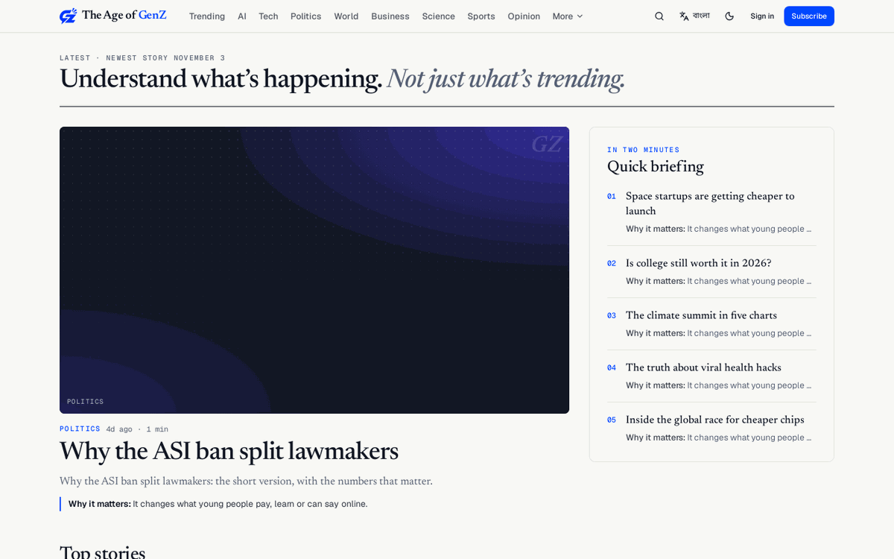
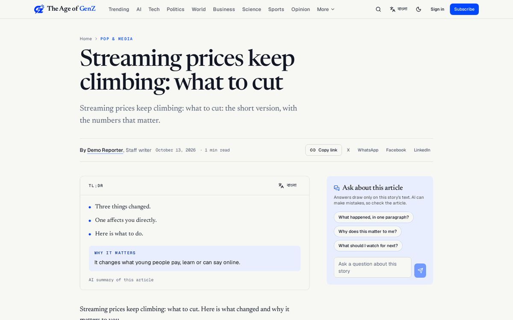
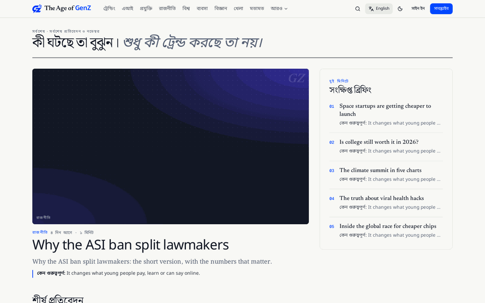
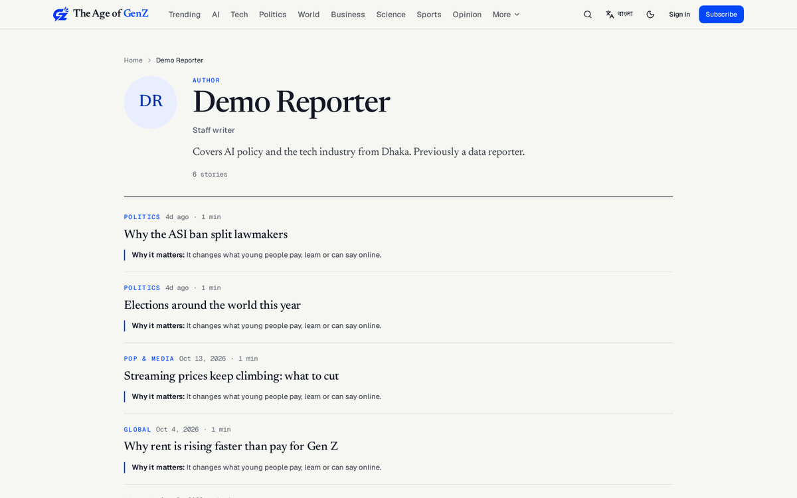
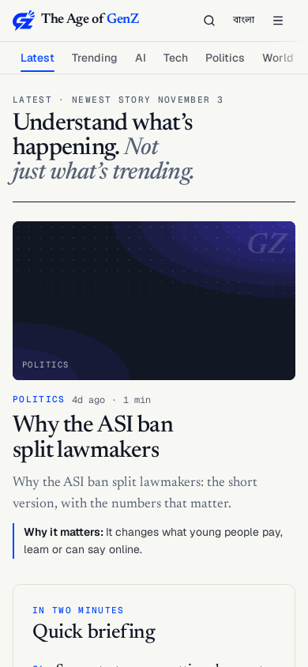
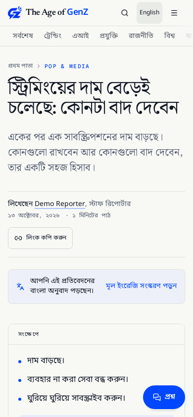

# The Age of GenZ (frontend)

[](https://github.com/Imnasir-X/ageofgenz_frontend/actions/workflows/ci.yml)


**Understand what's happening. Not just what's trending.**

The Age of GenZ is a youth-focused, international news and explainer site. Every story leads with a
short TL;DR and a plain "why it matters" line, readers can ask questions about an article and get
answers grounded only in its text, and the whole interface switches between English and Bangla.
This repo is the reader site and the staff Studio; the Django API and the AI newsroom live in the
private [ageofgenz_backend](https://github.com/Imnasir-X/ageofgenz_backend) repo.

Live site: [theageofgenz.com](https://theageofgenz.com)



| Article page | Bangla interface | Author page |
|---|---|---|
|  |  |  |

| Phone (390 px) | Bangla article on a phone |
|---|---|
|  |  |

Screenshots are from a local run against the backend's demo data.

## Features

### For readers

- **Home**: a lead story, a "Quick briefing" of five stories in two minutes, top stories and section rails.
- **Sections**: Trending, AI, Tech, Politics, World, Business, Science, Sports, Opinion and more, with swipeable section tabs on phones.
- **Article pages**: TL;DR bullets, a "why it matters" line, byline and dates, share links, related stories, and an approved Bangla translation when one exists.
- **Ask about this article**: reader questions answered only from the story's own text, with quotes. The feature hides itself when the backend does not offer it.
- **Bangla toggle**: one button in the header switches every interface string between English and Bangla (Noto Sans and Noto Serif Bengali). The choice is remembered on the device, sets `<html lang>`, and works on every page, including article, author and 404 pages.
- **Author pages** at `/author/<slug>/`: photo or initials, role, bio and the author's stories.
- **Search**: a command palette (`Ctrl+K`, `Cmd+K` or `/`) and a full results page with section filters.
- **Dark mode**, newsletter sign-up, donations and subscriptions, sign-in with email or Google.

### Under the hood

- **Prerendered pages**: the home, section, article and author pages are rendered to static HTML at build time for fast first paint and search engines. Unknown URLs get a real 404 status.
- **Server-rendered fallback for new articles**: `api/article-proxy.js` (a Vercel Edge Function) renders articles published after the last build, with the same HTML for people and crawlers.
- **SEO**: canonical URLs, Open Graph and Twitter tags, `NewsArticle` JSON-LD, sitemaps served from the API through Vercel rewrites, and `llms.txt`.
- **Accessibility**: checked with axe at 360, 390 and 1440 px in both languages (no serious or critical issues), visible focus rings, `role="status"` loading skeletons, no horizontal scrolling on phones.
- **Studio** at `/studio`: the staff console for today's queue, articles, the newsroom, categories, media, newsletter, donations, users, analytics and settings. It is client-only, never prerendered and never listed for crawlers.
- **Optional AI features**: the article page reads the backend's Hermes newsroom endpoints (`/api/newsroom/`, see `src/lib/api/client.ts`) for the summary (`tldr`, `why_it_matters`), the approved Bangla translation, reader Q&A and related stories. Each feature hides itself when its endpoint returns 404 or 503, so the site works with or without Hermes.

## Tech stack

| Area | Technology |
|---|---|
| UI | React 19, TypeScript 5.7, Tailwind CSS 3, Radix UI primitives, lucide icons |
| Build and rendering | Vite 6, vite-plugin-ssr prerendering, Vercel Edge Function for new articles |
| Routing and data | React Router 7, Axios |
| Studio | TipTap editor, Recharts |
| Fonts | Newsreader, Geist, Geist Mono, Noto Sans Bengali, Noto Serif Bengali |
| Tests | Vitest, Testing Library, jsdom |
| CI | GitHub Actions: typecheck, lint, tests, full prerender build, `npm audit` (production deps) |
| Hosting | Vercel (frontend), Render (Django API) |

## Getting started

### Prerequisites

- Node.js 20.19 or later (CI uses Node 22)
- npm

### Run against the production API

```bash
git clone https://github.com/Imnasir-X/ageofgenz_frontend.git
cd ageofgenz_frontend
npm ci
npm run dev
```

The dev server runs on http://localhost:3000. Without `VITE_API_URL` it reads the production API.

### Run the full stack locally (backend, demo data and this frontend)

Clone both repos side by side, then start everything with one command from the backend repo:

```bash
cd ../ageofgenz_backend
./run-local.sh            # Windows PowerShell: .\run-local.ps1
```

Or run the frontend on its own against a local backend on port 8000:

```bash
npm run dev:local         # Vite on :3000 with VITE_API_URL=http://localhost:8000
```

URLs, demo accounts and troubleshooting are in [LOCAL_RUN.md](LOCAL_RUN.md).

## Tests and build

| Command | What it does |
|---|---|
| `npm run typecheck` | `tsc -b` across the app and tooling configs |
| `npm run lint` | ESLint |
| `npm test` | Vitest (rendering, i18n and author pages, search palette, consent, SEO, API client, Studio) |
| `npm run build` | Typecheck, Vite build with prerendering, then `scripts/postbuild.mjs` |
| `npm run preview` | Serve the production build locally |

`scripts/postbuild.mjs` fails the build if core pages were not prerendered, if `/studio` was prerendered,
or if `llms.txt` mentions the Studio. It also publishes the prerendered 404 page as `404.html`.

## Environment variables

Set these in `.env.local` for local work and in the Vercel project for deployments. Never commit real values.

| Variable | Purpose |
|---|---|
| `VITE_API_URL` | Base URL of the Django API. Defaults to the production API when unset. |
| `VITE_GOOGLE_CLIENT_ID` | Google OAuth client ID for "Sign in with Google". |
| `VITE_GA_ID` | Google Analytics 4 measurement ID. Analytics loads only when it is set (IP anonymised). |

## Deployment

The site deploys on **Vercel**. Vercel runs `npm run build` and serves `dist/client`
(see `vercel.json`, which also holds the `www` to apex redirect, trailing-slash redirects and the
article proxy rewrite). Pushes to `main` deploy production, and every pull request gets a preview
deployment. The backend runs separately on Render; the full runbook for both is `DEPLOY.md` in the
backend repo.

## Project structure

```
src/
  pages/         reader pages (home, section, article, author, search, legal, account)
  components/    layout, news cards and states, UI primitives, SEO
  lib/           API client, i18n (English and Bangla strings, toggle), search, dates, images
  studio/        staff console at /studio
  renderer/ ssr/ prerender and server rendering entry points
  test/          Vitest suites
api/             Vercel Edge Function for articles published after the last build
scripts/         dev-local and postbuild scripts
```

## Author

Built by [Nasir Khan](https://imnasir-x.github.io/portfolio/) ([@Imnasir-X](https://github.com/Imnasir-X)).
